<div align="center">
# MORPHEUS

### Adaptive Adversary Deception & Intelligence Platform

**Observe. Analyze. Adapt. Deceive.**

A modular cybersecurity research platform that turns honeypot activity
into actionable investigation context through telemetry, threat
intelligence, risk analysis, and controlled deception.


</div>

------------------------------------------------------------------------

## What is MORPHEUS?

MORPHEUS is a cybersecurity research platform built around a Cowrie SSH
honeypot. It collects attacker activity, reconstructs sessions, extracts
indicators, supports behavioral and risk analysis, and provides
workflows for controlled deception and investigation.

> **Research project:** Components have different levels of validation.
> MORPHEUS is not a production-ready SOC or an autonomous
> malware/zero-day detection system.

## Core capabilities

| Capability | What it does |
|---|---|
| **Honeypot telemetry** | Collects and processes Cowrie SSH activity |
| **Session intelligence** | Reconstructs sessions and analyzes attacker behavior |
| **Threat intelligence** | Extracts IOCs and supports IP/network enrichment |
| **Risk analysis** | Produces structured, explainable risk assessments |
| **Adaptive deception** | Supports deception personalities, planning, and Cowrie lifecycle control |
| **Campaign analysis** | Correlates related attacker activity |
| **Distributed sensors** | Forwards events to a central collector using authenticated delivery |
| **Purple Team & dashboard** | Provides scenario workflows, REST/WebSocket APIs, and a React interface |
| **Artifact handling** | Includes initial capture and static heuristic analysis; samples are not executed |

## Distributed collection flow

The following diagram shows the distributed sensor-to-dashboard workflow.

```mermaid
flowchart LR
    A["Attacker"] --> B["Cowrie Honeypot"]
    B --> C["MORPHEUS Sensor"]
    C --> D["Persistent Queue"]
    D --> E["FastAPI Collector"]
    E --> F["Central Analysis Worker"]
    F --> G["Risk & Threat Intelligence"]
    G --> H["REST API / WebSocket"]
    H --> I["React SOC Dashboard"]
```



**The flow:** Cowrie records activity → the sensor queues and forwards
events → the collector stores them → the analysis worker processes them
→ the dashboard presents available investigation data.

## Highlights

-   **Distributed collection verified:** A local integration test
    confirmed Cowrie events were captured, forwarded with authenticated
    requests, processed by the central worker, and removed from the
    delivery queue after successful forwarding.
-   **Adaptive deception demonstration:** A recorded high-risk scenario
    selected the `enterprise_database` personality, with simulated
    hostname `db-prod-01`, deception level `3`, and SSH/MySQL/Redis
    services.
-   **Automated tests:** The latest recorded full test run completed
    with **443 passed**.

These are validation snapshots from the development environment, not
guarantees of production-scale reliability.

## Technology

`Python` · `FastAPI` · `Cowrie` · `Docker Compose` · `React` · `Vite` ·
`pytest` · `JSONL` · `MITRE ATT&CK`

## Get started

### Requirements

-   Linux (validated on Ubuntu under WSL2)
-   Python 3 and `venv`
-   Docker Engine and Docker Compose
-   Node.js and npm (for the dashboard)

### 1. Clone and install

``` bash
git clone https://github.com/BobCat007/MORPHEUS.git
cd MORPHEUS

python3 -m venv .venv
source .venv/bin/activate
python -m pip install -r requirements.txt
```

### 2. Run the tests

``` bash
.venv/bin/pytest -q
```

### 3. Start the honeypot

``` bash
cd deployment/cowrie
docker compose up -d
```

The default Compose mapping publishes Cowrie on host port `2222` and may
expose it on all host interfaces. For local-only testing, change the port
mapping in `deployment/cowrie/docker-compose.yml` to
`127.0.0.1:2222:2222` before starting the service. Test only with
disposable credentials:
``` bash
ssh -p 2222 test@127.0.0.1
```

Stop it with `docker compose down`.

## Run the backend

Configure the environment using the templates in `deployment/systemd/`
before starting the relevant processes.

**API**

``` bash
.venv/bin/uvicorn api.app:app --host 127.0.0.1 --port 8000
```

Health check: `http://127.0.0.1:8000/api/v1/health`

**Central analysis worker**

``` bash
.venv/bin/python -m telemetry.sensor.analysis_worker
```

**Standalone sensor**

``` bash
.venv/bin/python -m telemetry.sensor.process
```

The sensor requires `MORPHEUS_COLLECTOR_URL`, `MORPHEUS_SENSOR_ID`, and
`MORPHEUS_SENSOR_TOKEN_FILE`. It also needs permission to read the
Cowrie log and write to its persistent queue.

For distributed deployment, configure unique sensor credentials and use
HTTPS between sensor and collector. See
`deployment/systemd/*.env.example` for configuration templates.

## Dashboard

``` bash
cd dashboard
npm ci
npm run dev
```

Open `http://127.0.0.1:5173`. The Vite development server proxies `/api`
and WebSocket traffic to the API at `127.0.0.1:8000`.

Build the dashboard with `npm run build`. More details:
[`dashboard/README.md`](dashboard/README.md).

## Project structure

``` text
api/             FastAPI application
core/            Events, security, configuration, storage
deception/       Deception personalities and controls
intelligence/    Session, campaign, intent and risk analysis
telemetry/       Cowrie ingestion and distributed sensors
threat_intel/    Threat intelligence integrations
purple_team/     Purple Team workflows
reporting/       Investigation and reporting
dashboard/       React + Vite interface
deployment/      Cowrie and systemd examples
tests/           Automated tests
```

## Validation

Run these checks from the repository root:

``` bash
.venv/bin/pytest -q
.venv/bin/python -m compileall -q api core intelligence purple_team telemetry threat_intel
cd dashboard && npm ci && npm run build
```

Latest recorded validation: **443 Python tests passed**, Python compile
check passed, and dashboard production build passed. Re-run checks after
changes and on your own environment.

## Safety notes

-   Keep the honeypot isolated and use disposable test credentials.
-   Do not expose the development API directly to the public internet.
-   Use HTTPS for remote sensor communication.
-   Protect token and environment files; never commit secrets.
-   Treat captured commands and artifacts as untrusted. Do not execute
    collected samples on the host.
-   Under WSL2, services run only while the WSL environment is running.

## Roadmap

**In progress:** advanced behavioral ML, intent prediction, broader
deception-service coverage, and production hardening.

MORPHEUS should not be represented as providing validated zero-day
detection.

## License

No license file was present during the documentation review. Until a
`LICENSE` file is added, do not assume permission to reuse,
redistribute, or modify this project.

------------------------------------------------------------------------

<div align="center">
**MORPHEUS** · Cybersecurity Research & Engineering

[GitHub Repository](https://github.com/BobCat007/MORPHEUS)
</div>
